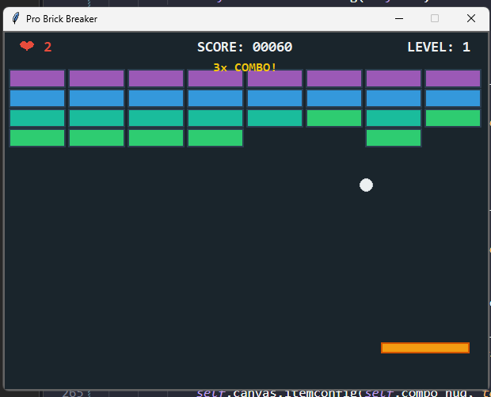

1. Fisika Pantulan Dinamis (Dynamic Paddle Bounce)
Modifikasi: Sebelumnya, bola hanya berbalik arah Y jika mengenai paddle. Sekarang, sudut pantulan bola berubah tergantung di bagian mana bola mengenai paddle (tengah lurus, pinggir menyamping). Algoritma math.hypot digunakan untuk menjaga kecepatan konstan.

Alasan: Ini adalah game design 101 untuk game Breakout. Ini memberi pemain kendali (kontrol) atas ke mana bola akan pergi, mengubahnya dari game yang murni "untung-untungan" menjadi game berbasis skill. Dosen/guru pasti sangat mengapresiasi logika ini.

2. Sistem Skoring Multiplier (Combo System)
Modifikasi: Jika bola menghancurkan beberapa bata sekaligus sebelum kembali menyentuh paddle, poin yang didapat akan berlipat ganda (10, 20, 30, dst). Terdapat UI teks kuning yang muncul saat combo terjadi.

Alasan: Membuat sistem reward menjadi sangat seru. Pemain akan tertantang untuk mengarahkan bola ke sela-sela bata (di atas) agar bola memantul berkali-kali tanpa jatuh.

3. Sistem Level Generatif (Endless Progression)
Modifikasi: Saat bata habis, game tidak langsung memunculkan tulisan "You Win!". Sebaliknya, game akan membuat susunan bata baru (Level 2, 3, dst), warna bata diacak lebih tebal (hingga 5 hit), dan kecepatan bola bertambah.

Alasan: Membuat game memiliki replay value (bisa dimainkan berulang-ulang) alih-alih selesai dalam 1 menit.

4. Input Gerakan Smooth (60 FPS Polling)
Modifikasi: Sebelumnya, paddle dikendalikan dengan bind('<Left>') yang kadang lagging atau tersendat karena jeda keyboard repeat rate bawaan sistem operasi. Sekarang input menggunakan deteksi KeyPress dan KeyRelease yang di-loop pada fungsi update_paddle_movement.

Alasan: Gerakan paddle sekarang terasa sangat mulus bagaikan game komersial sungguhan.

5. Estetika & UI yang Jauh Lebih Profesional

Modifikasi:Menggunakan font Consolas yang terkesan retro-modern.
Menambahkan batas root.resizable(False, False) agar layout rapi.
HUD dirombak untuk menampilkan Logo Nyawa (❤), Score dengan format nol di depan (00150), Level, dan Combo.
Skema warna diubah menjadi palet ala Neon/Material Design dengan background #1a252c yang nyaman di mata.

Alasan: Estetika adalah hal pertama yang dilihat saat tugas dinilai. Tampilan yang bersih dan modern memberikan impresi bahwa kode ditulis dengan sangat serius.